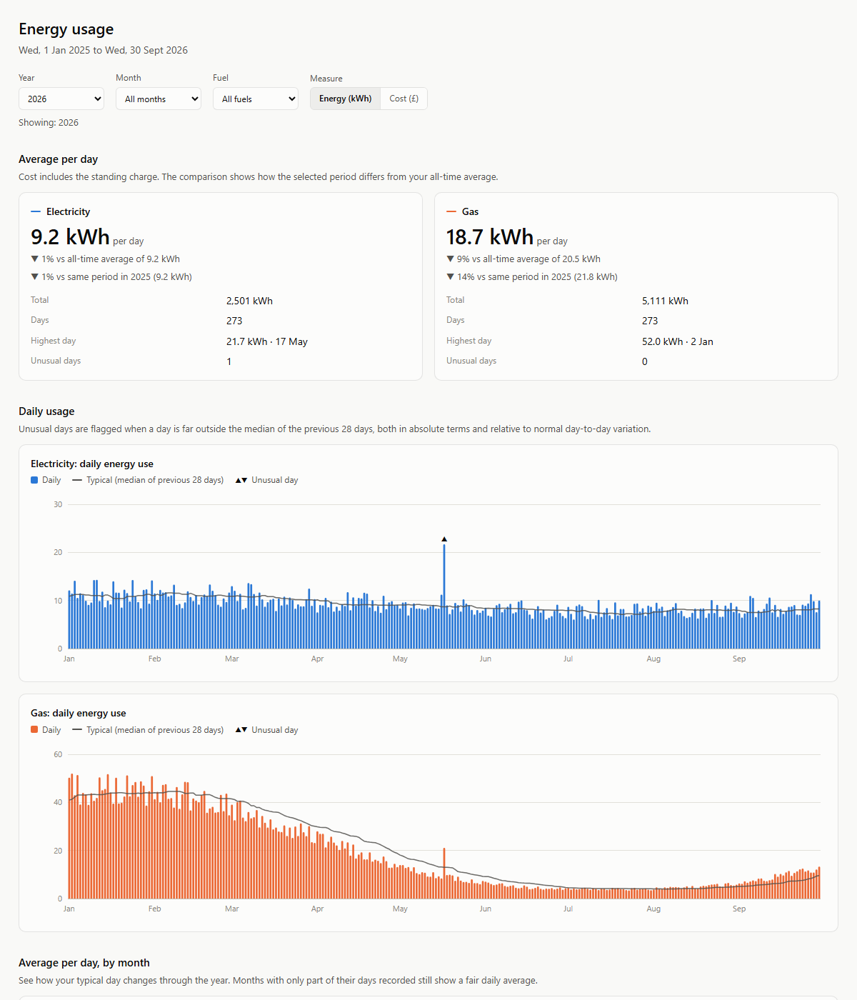

# British Gas usage export

Download your daily smart meter usage and costs from your British Gas online account, save them as CSV, and explore them in a local dashboard.



> **Unofficial.** This isn't affiliated with or endorsed by British Gas. It calls the same internal API that the British Gas website uses, so it can stop working whenever they change it. Use it only with your own account, at your own risk.

## What it does

1. Opens a browser window so you can log in to British Gas yourself, including any two-factor step. The script never sees your password.
2. Reads the access token the website uses for its own requests.
3. Downloads daily usage (kWh) and cost (£, including the standing charge) for each of your meters, one month at a time.
4. Writes CSV files and builds `dashboard.html`, which opens in your browser.

## Requirements

- A British Gas online account with a smart meter. The usage page on the website must show daily figures.
- Python 3.10 or newer.
- Google Chrome is recommended. Without it, the script falls back to Playwright's bundled Chromium.

## Setup

```
pip install -r requirements.txt
python -m playwright install chromium
```

## Usage

```
python bg_export.py
```

The script asks how much history to download: everything, a number of months, or a number of years. You can also pass the range directly:

```
python bg_export.py --all
python bg_export.py --months 6
python bg_export.py --years 2
python bg_export.py --start 2025-01-01 --end 2025-12-31
```

Other options:

| Option | What it does |
|---|---|
| `--reconfigure` | Detect your account and meters again |
| `--no-dashboard` | Only write the CSV files |
| `--include-empty` | Keep days the API marks as having no data |
| `--timeout N` | Seconds to wait for you to log in (default 300) |
| `--out DIR` | Output folder (default `output/`) |

By default the download stops 2 days before today, because smart meter data arrives about a day late and the most recent day is usually incomplete.

### First run

On the first run the script needs your account and meter IDs. It works them out by watching the website's own requests:

1. Log in when the browser opens.
2. Open the energy usage page. If you have both gas and electricity, switch between them so the site loads both.
3. Press Enter in the terminal, then confirm which meter is electricity and which is gas.

The IDs are saved to `bg_config.json`. Later runs reuse them, and the browser profile in `.browser-profile/` usually keeps you logged in.

## Output

All files are written to `output/`:

| File | Contents |
|---|---|
| `british_gas_usage.csv` | One row per day per meter |
| `electricity.csv`, `gas.csv` | The same rows, split by fuel |
| `raw/*.json` | The untouched API responses |
| `dashboard.html` | The dashboard. It is self-contained and works offline |

CSV columns:

- `date`, `meterpoint`, `fuel`, `has_data`
- `standing_charge`
- `standard_kwh`, `standard_cost`: the day's total usage and cost
- `peak_kwh`, `peak_cost`, `offpeak_kwh`, `offpeak_cost`: time-of-use breakdown, if your tariff has one
- `total_cost`: `standard_cost` plus `standing_charge`

## Dashboard

You can filter by year, month (for example every September), fuel, and energy or cost. The dashboard shows:

- Average use per day for each fuel, compared with your all-time average and with the same period last year.
- Daily charts with a "typical" line, which is the median of the previous 28 days.
- Unusual days, marked ▲ or ▼. A day is unusual when it is far from typical, both in absolute terms and relative to normal day-to-day variation. The thresholds are at the top of the script in `dashboard_template.html`.
- Average per day by month and by day of week.
- A table of unusual days and a monthly summary table.

To rebuild the dashboard from an existing CSV without logging in:

```
python dashboard.py                              # output/british_gas_usage.csv
python dashboard.py examples/sample_usage.csv    # try it with made-up data
```

Expect the start of the heating season to show up as unusual gas days. The typical line takes a few weeks to catch up with a seasonal rise.

## Privacy

Everything runs on your computer. These files are personal, and `.gitignore` keeps them out of git:

- `.browser-profile/`: your logged-in British Gas session. Treat it like a password.
- `bg_config.json`: your account and meter numbers.
- `output/`: your usage history.

## Troubleshooting

- **British Gas shows "Sorry, we're having technical problems".** This usually means the saved login has expired. The script detects this page, clears the saved login and reloads the sign-in page automatically. If the error comes back after that, the site itself is probably having problems, so try again later. Deleting `.browser-profile/` also gives you a completely fresh start.
- **The script keeps waiting after you log in.** Open the energy usage page. The script continues once the site makes its first data request.
- **`FAILED ... HTTP 401` or `403`.** Your session expired or the token wasn't captured. Run the script again and open the usage page after logging in. The headers the script used are saved, with the token shortened, to `output/raw/captured_headers_redacted.json`.
- **Meters are labelled with the wrong fuel.** Run with `--reconfigure`, or edit `bg_config.json`.
